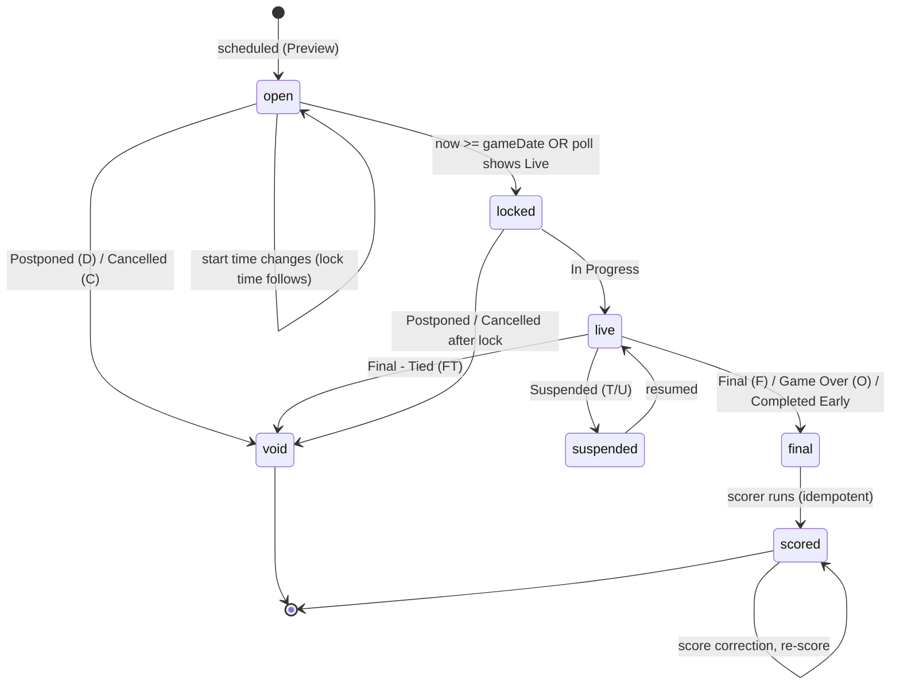
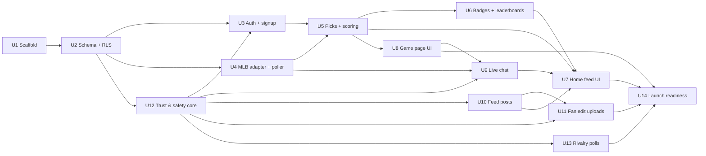

# feat: Caught Looking v1 — teen MLB fan app

**Target repo:** `caught-looking` (new, greenfield)

## Overview

Caught Looking is a Reddit-style hangout for teen MLB fans. Version 1 ships everything at once: a feed home screen (games strip, pick card, live chat preview, clips and fan edits), per-game prediction picks with hit rate, badges and leaderboards, live per-game chat, fan-uploaded video edits, rivalry polls, and a moderation system with fan mods under adult admins.

This plan defines how to build it on Next.js 16 + Supabase, and front-loads the safety, legal and data-licensing work that a teen app with chat and uploads cannot launch without.

---

## Problem Frame

Teen baseball fans find baseball media boring and scattered. The product bets that daily predictions (with a public hit rate and badges) give fans a reason to return, and that clips, fan edits and live chat make it a place to hang out (see origin: Build Plan, "The idea").

The builders are a parent and his teen son working with Claude Code. That shapes the plan in three ways: the stack must be one that agents build well and that runs cheaply; safety must be designed in, because the audience is minors; and the riskiest external dependencies (MLB data terms, age and content law) must be isolated so they can change without a rewrite.

---

## Requirements Trace

Carried from the origin Build Plan and the prototype canvas, plus the decisions made in conversation on 2026-10-21.

- R1. Covers all 30 MLB teams; target audience is teens 13+.
- R2. Sign up with a username and a favorite team; no real names, photos, locations or private messages.
- R3. Home screen is the feed layout (prototype "Home, version B"): hit-rate chip in header, today's games strip, "Make your pick" card, live chat preview, feed of MLB clip links and fan edits sorted Hot / New / My Team; offseason news fills the feed.
- R4. Game page: before first pitch, the pick poll and fan split; after the final, the score, pick result, updated hit rate, any new badge, and MLB highlight links; live chat during the game.
- R5. One pick per user per game, locked at first pitch, scored after the final.
- R6. Hit rate shown after 10 picks; leaderboard ranks qualified users by hit rate, tiebreak total correct; fan-base board by favorite team.
- R7. Badges: Rookie Card, Hot Streak, Perfect Game, Upset Special, Iron Man, Ace, Caught Looking.
- R8. Live game-day chat in v1.
- R9. Fan-uploaded short video edits in v1, with upvotes and comments.
- R10. Rivalry polls in v1.
- R11. Fan moderators in v1.
- R12. Report button and bad-word filter on all user content.
- R13. MLB highlights are linked, not hosted.
- R14. No money, no betting, no prizes — bragging rights only.
- R15. Phone-first web app first; App Store app (Expo) later.

---

## Scope Boundaries

- No direct messages, friends lists, or private group chats.
- No prizes, currency, purchasable items, odds, or betting language (R14).
- No hosting or re-streaming of MLB video; MLB clips are link cards to MLB.com (or official YouTube embeds) only (R13).
- No MLB or club logos, and no "MLB" or club names in the app name, icon or store screenshots.
- No algorithmic, engagement-ranked personal feed, autoplay video, or infinite scroll in v1 (keeps the app clearly outside Florida HB 3's "addictive feature" tests).
- No push notifications in v1.
- No native mobile app in v1.

### Deferred to Follow-Up Work

- Expo / App Store and Play builds, including Apple Declared Age Range and Play Age Signals integration: separate plan once the web app is stable.
- Licensed sports data provider (Sportradar, SportsDataIO or MySportsFeeds) behind the U4 adapter: before any public launch if MLBAM permission is not obtained.
- Server-side video transcoding (Mux, Cloudflare Stream or Ittybit): after v1 if original-file playback proves unreliable.

---

## Context & Research

### Relevant Code and Patterns

Greenfield: there is no existing repo, local pattern, or `docs/solutions/` learning to follow. The prototype canvas is the visual reference for the Home (version B) and Game page screens: `Main.dc.html` (home A, reference only), `HomeFeed.dc.html` (chosen home), `GamePage.dc.html`.

### External References

- MLB Stats API, checked against live responses on 2026-10-21: `/api/v1/schedule?sportId=1&date=…&hydrate=linescore,team`, `/api/v1/gameStatus`, `/api/v1/game/{gamePk}/content`. Every response carries an MLBAM notice limiting use to "individual, non-commercial, non-bulk use" ([copyright.txt](http://gdx.mlb.com/components/copyright.txt)).
- Supabase docs: [Realtime authorization](https://supabase.com/docs/guides/realtime/authorization), [Broadcast](https://supabase.com/docs/guides/realtime/broadcast), [RLS](https://supabase.com/docs/guides/database/postgres/row-level-security), [Storage file limits](https://supabase.com/docs/guides/storage/uploads/file-limits), [Resumable uploads](https://supabase.com/docs/guides/storage/uploads/resumable-uploads), [Cron](https://supabase.com/docs/guides/cron), [Edge Function limits](https://supabase.com/docs/guides/functions/limits), [Next.js SSR auth](https://supabase.com/docs/guides/auth/server-side/nextjs), [Testing](https://supabase.com/docs/guides/local-development/testing/overview).
- Versions on npm, 2026-10-21: `next` 16.4.2, `@supabase/ssr` 0.12.7, `@supabase/supabase-js` 2.118.0, `@playwright/test` 1.64.1. Next 16 moved request middleware to `proxy.ts`.
- FTC [COPPA FAQ](https://www.ftc.gov/business-guidance/resources/complying-coppa-frequently-asked-questions) (neutral age screens); amended COPPA rule compliance date April 22, 2026.
- 18 USC 2258A as amended by the REPORT Act ([Public Law 118-59](https://www.congress.gov/118/plaws/publ59/PLAW-118publ59.htm)): report apparent CSAM to NCMEC and preserve it for one year.
- Florida HB 3 now enforceable ([Florida Phoenix, Oct 14, 2026](https://floridaphoenix.com/2026/10/14/appeals-court-lifts-block-on-florida-law-restricting-social-media-access-for-teens/)).
- [Apple App Review Guidelines](https://developer.apple.com/app-store/review/guidelines/) 1.2 (UGC: filter, report, block, contact), 5.3.4 (prediction apps with prizes), 5.2.1 (trademarks); [Google Play UGC policy](https://support.google.com/googleplay/android-developer/answer/12923286) and [Child Safety Standards](https://support.google.com/googleplay/android-developer/answer/14747720).
- [OpenAI moderation](https://developers.openai.com/api/docs/guides/moderation) (free text + image) and [AWS Rekognition](https://aws.amazon.com/rekognition/pricing/) (stored-video moderation, about $0.10/min).

This plan summarizes legal research; it is not legal advice. U14 includes a lawyer review before public launch.

---

## Key Technical Decisions

- **Next.js 16 App Router + Supabase (Postgres, Auth, Realtime, Storage, Cron, Edge Functions):** one managed backend covers every v1 need, and agents build this pair well. Use the Supabase Pro plan from the start: Free caps files at 50 MB (too small for 60 s video), pauses idle projects (breaks the poller), and limits Realtime to 200 connections.
- **Auth = synthetic email + password, plus a recovery code, all server-side:** Supabase has no username-only login. Public Supabase signups are disabled. A server action checks the invite code, Turnstile, the age screen result and the username pipeline, generates a UUID, then calls `auth.admin.createUser` with that id, the internal address `<id>@users.caughtlooking.invalid` (not the username, so renames don't touch auth) and `email_confirm: true`, and creates the profile in the same request, rolling back on failure. Login is a server action that resolves the normalized username to an id with the service role, then signs in and sets the session cookie, so the username-to-id mapping is never exposed. The recovery code is at least 16 base32 characters (80+ bits), hashed with argon2 or bcrypt, rotated after each use, and viewable or regenerable from settings while signed in. A reset revokes all sessions. This collects no email from minors and works across devices. Rejected: anonymous sign-ins (account lost when the browser is cleared) and real email (collects minors' contact data and needs custom SMTP).
- **Client roles can only read; every write goes through a checked server path:** PostgREST exposes every table, so RLS alone would let a teen with devtools skip the filter, rate limits, age gate and invite check. Authenticated users get SELECT only on content tables (`chat_messages`, `posts`, `comments`, `polls`, `poll_votes`, `votes`, `picks`, profile name columns). Writes happen only through `security definer` RPCs or service-role Edge Functions that run the filter and limit checks. `realtime.messages` policies allow subscribe only and deny client INSERT, so broadcasts come only from the database trigger. A pgTAP test per table proves a direct authenticated insert is rejected.
- **Internal functions and secrets are locked down:** cron- and trigger-invoked Edge Functions (`poll-games`, `score-games`, `scan-upload`, `scan-complete`, `ingest-highlights`, `ingest-news`) reject any caller without a shared secret or service-role JWT stored in Vault, and derive their inputs from database or storage records, not request bodies. A secrets inventory in `docs/policies/security-program.md` lists where each secret lives (Supabase function secrets, hosting env, CI secrets), separates local and production keys, scopes the AWS IAM user to the scan bucket and Rekognition only, sets a rotation cadence, and states that the service-role key never appears in client code or any `NEXT_PUBLIC_` variable. CI runs a secret scan.
- **Neutral age screen before anything is stored:** free entry of birth month and year, no hint of the cutoff, a no-retry device flag on failure, and only an `age_verified_13_plus` flag plus birth year kept.
- **All authorization in the database:** RLS on every table, `(select auth.uid())` pattern, `to authenticated`, one policy per operation, roles in a `user_roles` table (never `user_metadata`), helpers as `security definer` in a private schema with empty `search_path`. The pick lock is enforced in Postgres, never only in the UI.
- **MLB data behind a server-only, provider-neutral adapter:** the app reads only from its own `games` table. `poll-games` is the only thing that calls MLB, including fetching highlight links after a final; `ingest-highlights` reads those stored links from the database. Games have an internal id plus `provider` and `provider_game_id` columns, and the adapter returns a provider-neutral status enum, so MLB's `gamePk` and status letters never leave `lib/providers/mlb/`. A switch to a licensed provider then means a new adapter and an id-mapping migration, not a rewrite; highlight links may not survive a switch, since licensed feeds generally don't supply MLB.com clip links.
- **Explicit game-state machine driven by the provider's detailed status:** for MLB, `abstractGameState == "Final"` also covers Postponed and Cancelled, so it must never trigger scoring on its own (see High-Level Technical Design).
- **Shared domain code lives where both runtimes can import it:** Edge Functions run on Deno and bundle from `supabase/functions/`. Runtime-neutral, dependency-free TypeScript (game state, scoring, badges, leaderboard rules, filters, the MLB adapter) lives in `supabase/functions/_shared/`, and Next.js imports it through a tsconfig path alias. Nothing in `_shared/` may import Node- or Next-specific modules.
- **Lock rule:** a pick locks at the earlier of the game's current scheduled `gameDate` or the first poll that shows a Live state. Lock times follow schedule changes. All times stored in UTC, shown in the device's timezone.
- **Game counting rules:** regular season and postseason count; spring training and the All-Star Game don't. Postponed, cancelled and tied games are void: pick rows are kept with status `void` and don't count toward hit rate or streaks. If the game is rescheduled, picking reopens and a new pick replaces the void row. Suspended games stay locked and are scored when completed. A "day" for Perfect Game and Iron Man is MLB's `officialDate`; Iron Man counts consecutive game days, so off days don't break it.
- **Fan split and top predictors' picks are hidden until you pick:** prevents copying and keeps Upset Special meaningful. Upset Special uses the split at lock time and needs at least 20 pickers.
- **Leaderboards are season-scoped:** season board with a 25-pick minimum, accounts at least 3 days old; hit-rate chip still unlocks at 10 picks (R6). Lifetime hit rate shown on the profile. Fan-base board pools all qualified users' picks per team, with at least 5 qualified users per team. Favorite team can change once per season.
- **Scoring runs every few minutes, not nightly:** a cron job (about every 2 minutes during game windows) polls scores and scores newly Final games idempotently; MLB score corrections trigger a re-score and badge recompute.
- **Chat = messages table + trigger broadcast on private per-game channels:** Broadcast scales past Postgres Changes' per-subscriber RLS checks. RLS on `realtime.messages` restricts which topics a user can subscribe to. `post-chat` checks sanctions on every send, so mutes and bans stop new messages immediately; the 10-minute JWT expiry bounds how long a banned user can keep reading. Every message passes the filter pipeline before insert. Broadcast sends the same payload to every subscriber, so live messages from blocked users are hidden in the blocker's client using their block list loaded at join; chat history loads through the block-filtered RPC.
- **One content-filter pipeline for all text:** normalize (case, lookalike characters, leetspeak), then bad-word list, then contact-info patterns (phone numbers, @handles, "snap/insta/discord", URLs), then OpenAI `omni-moderation-latest`. Used for usernames, chat, post titles, comments and poll text. It fails closed: if the moderation API times out or errors, chat and usernames fall back to the local wordlist and contact checks and borderline text is held, not posted. Only the text is sent to OpenAI (and only the video to AWS), with no user identifiers, and both processors are named in the privacy notice.
- **Uploads are pre-moderated, write-once, and scanned asynchronously:** resumable (TUS) upload to a private `uploads/{user_id}/` bucket whose storage policies allow INSERT only, no UPDATE, and DELETE only before scanning. The server allow-lists MP4 and MOV and checks magic bytes, not just the extension. `scan-upload` copies the object to a short-retention S3 bucket and starts an asynchronous Rekognition content-moderation job with an SNS callback; `scan-complete` receives the result (a cron sweep polls any job still pending), checks duration from Rekognition's `VideoMetadata.DurationMillis` (over 60 s is rejected), routes the upload, and deletes the S3 copy. Explicit-nudity labels on a teen-audience upload are auto-rejected with an admin alert, not sent to the approval queue. A CSAM hash-matching service (Thorn Safer or Google CSAI Match) runs on extracted frames; a match goes to quarantine and is never shown to anyone. Everything else waits for human approval. Approved files are copied into a separate `media` bucket keyed by content hash and served with `nosniff` headers. A scan that times out goes to the admin queue marked "unscanned." Thumbnails are captured in the browser; the original file plays (no transcoding in v1).
- **Two-tier moderation:** fan mods can hide content, mute in chat, and resolve ordinary reports; adult admins (Jason, and any adult he names) alone can ban, approve uploads, handle "urgent" and "under 13" reports, and run the CSAM procedure. Every mod action is audit-logged.
- **Feed is paginated and chronological or vote-sorted:** "Hot" is a simple time-decayed vote score, not a personalized ranking; page through with a "Load more" button (no infinite scroll), no autoplay.
- **Testing:** pgTAP (`supabase test db`) for RLS and database rules, Vitest for domain logic (state machine, scoring, badges, filters), Playwright for end-to-end against the local Supabase stack, recorded MLB JSON fixtures for edge-case games.

---

## Open Questions

### Resolved During Planning

- Are chat and fan edits in v1? Yes — the user chose "everything day one." Mitigated by pre-moderation and the two-tier mod model.
- How do users recover accounts without email? Recovery code at signup (Key Technical Decisions).
- What triggers the pick lock, and how are postponed, suspended and tied games handled? See Key Technical Decisions and the game-state diagram.
- Which chat shows on Home when several games are live? The user's favorite team's game if live, otherwise the live game with the most chat activity, with a switcher; when none is live, show the next game's start time.
- Do fan split and top picks show before picking? No, only after.
- What happens on account deletion? After a confirmation that says it can't be undone: text posts, comments and chat are anonymized to "[deleted]"; uploaded videos are hard-deleted from storage; picks stay in historical splits but are detached from the user; the username is held for 90 days; mod and ban logs are kept for 1 year. A safety hold overrides this: if the user has an open urgent, under-13 or CSAM report, or an active sanction, their content is moved to an admin-only store instead of deleted, and a hashed identifier plus the ban record are kept so deletion can't lift a ban. Content tied to a CyberTipline report is preserved for one year.
- How do postponed-and-made-up games avoid flapping? When one provider game id appears twice in a schedule response (postponed today, rescheduled tomorrow), the entry with the latest `officialDate` wins, and picks reopen only on the `void → open` transition, never on a routine poll.

### Assumptions Requiring Owner Confirmation (blocking public launch, not the build)

- **MLB data terms:** MLB's notice permits only individual, non-commercial use. Assume private testing with friends is acceptable during the build; before any public launch, either get written MLBAM permission or switch the adapter to a licensed provider.
- **Adult admins:** assume Jason is the admin and named contact for child safety, NCMEC reporting and DMCA notices.
- **Legal review:** assume a short lawyer review of the age gate, state teen laws, terms and child-safety procedure happens before public launch.

### Deferred to Implementation

- Exact Rekognition confidence thresholds for auto-reject versus send-to-human: tune against real test clips.
- Hot-score decay constant: tune once there is real voting data.
- Exact cron cadence outside game windows: depends on observed schedule-change frequency.
- Which news RSS sources are on the allow-list: pick during U10 from sources with stable, family-friendly feeds.

---

## Output Structure

    caught-looking/
      app/                      # Next.js App Router routes
        (auth)/signup/, login/, recover/
        (main)/page.tsx         # Home feed
        (main)/game/[gamePk]/
        (main)/leaderboard/, profile/, post/new/, polls/
        (admin)/mod/            # mod + admin queues
        rules/, terms/, privacy/, child-safety/, contact/
      components/               # UI components (feed, game strip, pick card, chat)
      lib/
        supabase/               # browser + server clients
        auth/                   # server-only signup and login actions
      proxy.ts                  # Supabase session refresh (Next 16)
      supabase/
        migrations/
        functions/
          _shared/              # runtime-neutral code imported by Next via path alias
            domain/             # game-state, scoring, badges, leaderboard rules
            filters/            # content-filter pipeline
            providers/mlb/      # MLB Stats API adapter (server only)
            alerts/             # admin email alerts
          poll-games/, score-games/, post-chat/, scan-upload/, scan-complete/,
          ingest-highlights/, ingest-news/, moderate-text/
        tests/                  # pgTAP
        seed.sql
      tests/
        unit/                   # Vitest
        e2e/                    # Playwright
        fixtures/mlb/           # recorded MLB JSON
      docs/
        plans/, policies/       # retention, security, CSAM and DMCA procedures

---

## High-Level Technical Design

> *This illustrates the intended approach and is directional guidance for review, not implementation specification. The implementing agent should treat it as context, not code to reproduce.*

**Game state machine.** The app's own `games.app_state` is derived from MLB's `codedGameState` on every poll.

A voided game whose provider id reappears on a later schedule returns to `open`; its void pick rows stay void until the user picks again, which replaces them.

**Unit dependencies.**

---

## Phased Delivery

- **Phase 1 — Foundations (U1–U4, U12):** repo, schema, auth with age gate, MLB poller, and the filter / report / block / roles core that every content feature depends on.
- **Phase 2 — The prediction loop (U5, U6, U8):** picks, scoring, badges, leaderboards, and the game page without chat. Playable with friends at this point, using fixture replay until real games resume.
- **Phase 3 — The social layer (U9, U10, U11, U13, U7):** chat (including its section on the game page), feed, uploads, rivalry polls, and the finished feed home screen.
- **Timing:** the 2026 postseason ends before Phase 2 is done, and spring training games don't count. Work backward from Opening Day 2027 (late March): Phase 2 by mid-February so it can be shaken out on fixture replay, Phase 3 by mid-March, and the private test in the first two weeks of the regular season.
- **Phase 4 — Launch readiness (U14):** policies, legal review, data licensing decision, load and safety drills.

---

## Implementation Units

- U1. **Project scaffold and test harness**

**Goal:** A running Next.js 16 app wired to a local Supabase stack, with all three test layers and CI.

**Requirements:** R15

**Dependencies:** None

**Files:**
- Create: `package.json`, `next.config.ts`, `proxy.ts`, `lib/supabase/client.ts`, `lib/supabase/server.ts`, `supabase/config.toml`, `vitest.config.ts`, `playwright.config.ts`, `.github/workflows/ci.yml`, `.env.example`
- Test: `tests/unit/smoke.test.ts`, `tests/e2e/smoke.spec.ts`, `supabase/tests/00_smoke.test.sql`

**Approach:**
- `@supabase/ssr` browser and server clients; session refresh in `proxy.ts`. Server-side authorization uses `getClaims()`, never `getSession()`.
- No ISR or CDN caching for any authenticated route.
- Design tokens from the prototype (night-game navy ground, amber accent, Anton display + DM Sans body) set once as CSS variables.
- CI runs a secret scan, then `supabase start`, pgTAP, Vitest, then Playwright.
- Public Supabase Auth signups disabled in `supabase/config.toml`.
- Shared runtime-neutral code in `supabase/functions/_shared/`, imported by Next through a tsconfig path alias.

**Test scenarios:**
- Happy path: the home route renders for a signed-out visitor and redirects to signup.
- Integration: CI boots the local stack and all three suites run green on an empty schema.
- Error path: calling `supabase.auth.signUp` directly from the browser client is rejected.
- Error path: CI fails when a test commit contains a service-role key.

**Verification:** A fresh clone runs locally and in CI with one documented setup step.

---

- U2. **Core schema and row-level security**

**Goal:** Tables, constraints and RLS for every v1 feature, so later units only add behavior.

**Requirements:** R2, R5, R6, R7, R8, R9, R10, R11, R12

**Dependencies:** U1

**Files:**
- Create: `supabase/migrations/*_core_schema.sql`, `supabase/migrations/*_rls.sql`, `supabase/seed.sql`
- Test: `supabase/tests/rls_profiles.test.sql`, `supabase/tests/rls_picks.test.sql`, `supabase/tests/rls_content.test.sql`

**Approach:**
- Tables: `profiles` (public: username, normalized_username unique, favorite_team_id, created_at), `profiles_private` (owner and admins only: birth_year, team_changed_season, deleted_at, recovery state), `invite_codes` (code hash, created_by, max_uses, used_count, expires_at), `app_settings` (including the `public_signup_open` flag that U14 flips), `teams`, `games` (id, provider, provider_game_id, official_date, game_date, coded_state, app_state, lock_at, scores, season_type, rescheduled_from, double_header, game_number, ended_at, final_score_hash, lock_split), `picks`, `badges`, `user_badges`, `user_stats` (season and lifetime), `posts` (kind: mlb_clip, fan_edit, news; status: pending, live, hidden, removed), `comments`, `votes`, `chat_messages`, `polls`, `poll_options`, `poll_votes`, `reports`, `blocks`, `user_roles`, `sanctions`, `mod_actions`, `recovery_codes`, `reserved_usernames`.
- Picks: unique (user_id, game_id), with status `active`, `correct`, `wrong` or `void`. Writes go through a `make_pick` RPC that checks `now() < games.lock_at` and `app_state = 'open'`, backed by a trigger.
- Authenticated users get SELECT only on content tables; all writes go through `security definer` RPCs or service-role functions (Key Technical Decisions).
- Users only ever read `posts` with status `live`, plus their own pending posts.
- Blocked users' content is filtered server-side (view or RPC) for every query; live chat broadcasts are the one exception, hidden client-side (U9).

**Patterns to follow:** Supabase RLS guidance (`(select auth.uid())`, `to authenticated`, `using` + `with check` on update).

**Test scenarios:**
- Happy path: a user inserts and changes their own pick before lock.
- Error path: updating a pick after `lock_at` is rejected; inserting a pick for another user is rejected.
- Error path: a user cannot read another user's pending fan edit; a fan mod cannot set `sanctions` rows of type ban.
- Error path: a direct authenticated INSERT into `chat_messages`, `posts`, `comments`, `votes`, `poll_votes` or `picks` is rejected, one test per table.
- Error path: another user cannot select `profiles_private.birth_year`.
- Edge case: two profiles whose usernames differ only by case or lookalike characters collide on `normalized_username`.
- Integration: deleting a profile anonymizes their posts and comments and detaches picks.

**Verification:** Every table has RLS enabled and a pgTAP test proving at least one forbidden action is blocked.

---

- U3. **Signup, age screen, login, recovery and account deletion**

**Goal:** Users join with a username and favorite team after a neutral age screen, can sign in on any device, recover without email, and delete their account.

**Requirements:** R1, R2, R12

**Dependencies:** U2, plus the filter pipeline from U12 for usernames (U12's filter module can land first within Phase 1)

**Files:**
- Create: `app/(auth)/signup/`, `app/(auth)/login/`, `app/(auth)/recover/`, `app/(main)/profile/settings/`, `lib/auth/signup-action.ts`, `lib/auth/login-action.ts`, `supabase/functions/recover-account/`
- Test: `tests/unit/age-screen.test.ts`, `tests/unit/username-rules.test.ts`, `tests/e2e/signup.spec.ts`, `supabase/tests/recovery.test.sql`, `supabase/tests/invite_codes.test.sql`

**Approach:**
- Flow: birth month/year (free entry, no cutoff hint) → under 13: generic "can't create an account" screen, no data saved, device flag set → invite code (skipped once `public_signup_open` is on) → house rules and terms (must accept) → username → favorite team → recovery code shown, and the user must type back its last 4 characters to continue → Home.
- Signup and login are server actions using the admin API (Key Technical Decisions); password chosen by user; Cloudflare Turnstile on signup, login and recovery.
- Recovery attempts are throttled per IP and per username together, so one person can't lock out someone else's recovery by guessing.
- Username rules: 3–20 characters, letters/digits/underscore; normalized and checked against reserved names (MLB, team and player names, admin, mod, staff), the bad-word list, contact patterns, and patterns that look like real names plus birth years.
- Deletion in settings, effective immediately, behavior as in Open Questions.

**Test scenarios:**
- Happy path: a 15-year-old completes signup and lands on Home with a recovery code shown once.
- Error path: entering a birth year that makes the user 12 shows the generic screen; going back and entering a new year is still blocked on that device.
- Error path: usernames "MLB_Official", "Adm1n", "snap_jake22" and a slur with lookalike characters are rejected with a neutral message.
- Happy path: recovery code plus username resets the password; the code then stops working.
- Error path: 5 wrong recovery attempts from one IP lock recovery from that IP for an hour; attempts from a different IP still work.
- Error path: an invalid, expired or fully used invite code is rejected; a valid code's use count goes up by one.
- Happy path: a recovery reset signs out every other session and shows a new recovery code.
- Error path: a user with an open urgent report who deletes their account has their content moved to the admin-only hold, not erased.
- Integration: account deletion removes the user's videos from storage and shows "[deleted]" on their comments.

**Verification:** No email, phone, real name or full birthdate is stored anywhere for any user.

---

- U4. **MLB provider adapter, game-state machine and poller**

**Goal:** The `games` table always reflects today's schedule and live scores, with correct app states.

**Requirements:** R1, R3, R4, R5

**Dependencies:** U2

**Files:**
- Create: `supabase/functions/_shared/providers/mlb/client.ts`, `supabase/functions/_shared/providers/mlb/map.ts`, `supabase/functions/_shared/domain/game-state.ts`, `supabase/functions/_shared/alerts/`, `supabase/functions/poll-games/`, `supabase/migrations/*_cron.sql`
- Test: `tests/unit/game-state.test.ts`, `tests/unit/mlb-map.test.ts`, `tests/unit/alerts.test.ts`, `tests/fixtures/mlb/*.json`

**Approach:**
- Adapter interface (schedule for a date range, linescores for live games, highlight links for a game) returning provider-neutral statuses, with the MLB Stats API as the first implementation; nothing outside the adapter knows the provider.
- pg_cron + pg_net calls `poll-games` with its Vault-stored secret: schedule for today and tomorrow every 15 minutes, linescores every 1–2 minutes while any game is locked or live, and highlight links once a game is final (stored on the game for `ingest-highlights`).
- Map each response to `app_state` per the state diagram; recompute `lock_at` from the latest scheduled start; store double-header and game-number fields; handle reschedules by provider game id, with the latest `officialDate` winning when one id appears twice.
- Never call MLB from browsers.
- The shared alerts module emails the admin on poller failures (3 failed polls in a row) and is reused by U5, U11 and U12.

**Test scenarios:**
- Happy path: a scheduled game fixture maps to `open` with `lock_at = gameDate`.
- Edge case: a start time moved 30 minutes earlier updates `lock_at`.
- Edge case: a Postponed fixture (abstract Final, coded D) maps to `void`, not `final`.
- Edge case: a Suspended fixture maps to `suspended`; its resumption days later maps through `live` to `final`.
- Edge case: Final - Tied maps to `void`; a split doubleheader yields two games with Game 1 and Game 2 labels.
- Edge case: spring training and All-Star games are stored but flagged as not counting.
- Error path: an MLB timeout or malformed response leaves existing rows untouched and logs an alert; three in a row emails the admin.
- Edge case: a game postponed today and rescheduled tomorrow, both in one poll, ends `open` on tomorrow's date and stays there across repeated polls.
- Error path: calling `poll-games` without its secret returns 401.

**Verification:** Replaying a recorded day of fixtures produces the expected states for every game, with no duplicate rows.

---

- U5. **Picks, lock enforcement and scoring**

**Goal:** Users pick a winner per game; picks lock fairly; results are scored within minutes of the final.

**Requirements:** R5, R14

**Dependencies:** U3, U4

**Files:**
- Create: `supabase/functions/_shared/domain/scoring.ts`, `supabase/functions/score-games/`, `supabase/migrations/*_make_pick_rpc.sql`, `components/pick-card/`
- Test: `tests/unit/scoring.test.ts`, `supabase/tests/pick_lock.test.sql`, `tests/e2e/pick-flow.spec.ts`

**Approach:**
- Unlimited changes before lock; the last pick counts. Pick timestamp recorded.
- Fan split and top predictors visible only after the viewer has picked; split snapshot stored in `games.lock_split` at lock.
- Scorer is idempotent (keyed on game id + `final_score_hash`, a hash of the final linescore), records `ended_at`, emails the admin on failure, runs after each poll, marks picks correct, wrong or void, updates `user_stats`, then hands off to badge evaluation.
- Copy uses "pick," never "bet"; no odds shown.

**Test scenarios:**
- Happy path: picking LAD, then LAD wins 4–2 → pick correct, hit rate updated.
- Edge case: a pick made 1 second before `lock_at` is accepted; 1 second after is rejected by the database.
- Edge case: a postponed game's picks become void and don't count; if the game is rescheduled, picking reopens.
- Edge case: running the scorer twice on the same final changes nothing the second time.
- Edge case: an MLB score correction that flips the winner re-scores the picks and recomputes badges.
- Error path: a scorer crash midway leaves no half-scored game (transaction per game).
- Integration: the fan split is hidden from a user who has not picked and visible right after they pick.

**Verification:** For a replayed fixture day, every counted game is scored correctly within one poll cycle of going Final.

---

- U6. **Badges, hit rate and leaderboards**

**Goal:** Hit rate, the seven badges, and season leaderboards (people and fan bases) follow written rules.

**Requirements:** R6, R7

**Dependencies:** U5

**Files:**
- Create: `supabase/functions/_shared/domain/badges.ts`, `supabase/functions/_shared/domain/leaderboard.ts`, `supabase/migrations/*_leaderboard_views.sql`, `app/(main)/leaderboard/`, `app/(main)/profile/`
- Test: `tests/unit/badges.test.ts`, `tests/unit/leaderboard.test.ts`, `supabase/tests/leaderboard.test.sql`

**Approach:**
- Badge rules: Rookie Card on first scored pick; Hot Streak at 5 consecutive correct scored picks ordered by game end time, voids skipped (repeatable, count shown); Perfect Game on an `officialDate` with 5+ counted games, all picked and all correct; Upset Special on a correct pick that under 30% of at least 20 pickers chose at lock; Iron Man on 30 consecutive game days with at least one pick; Ace at 70%+ over 50+ scored picks in a season; Caught Looking on the first wrong pick (one-time, playful).
- Hit-rate chip shows "x of 10 picks to unlock" until 10 scored picks.
- Season leaderboard: 25+ scored picks, account 3+ days old; ties share a rank. Fan-base board pools picks of qualified users by favorite team, 5+ qualified users per team.
- Leaderboards computed as materialized views in the private schema (materialized views can't carry RLS), refreshed concurrently after scoring, and read through `security definer` RPCs that exclude banned and deleted users.

**Test scenarios:**
- Happy path: 5 correct in a row awards Hot Streak; a void in the middle doesn't break it.
- Edge case: an All-Star break doesn't break Iron Man.
- Edge case: Upset Special is not awarded when only 12 users picked the game.
- Edge case: a user with 24 scored picks does not appear on the season board; with 25 they do.
- Edge case: two users with identical hit rate and correct count share a rank.
- Integration: a re-score that turns a correct pick wrong removes a badge only if its rule no longer holds.

**Verification:** Every badge rule has at least one award and one non-award unit test.

---

- U7. **Home feed screen**

**Goal:** The chosen home screen (prototype "Home, version B") built against live data.

**Requirements:** R3

**Dependencies:** U5, U6, U9, U10

**Files:**
- Create: `app/(main)/page.tsx`, `components/games-strip/`, `components/chat-preview/`, `components/feed/`, `components/hit-rate-chip/`
- Test: `tests/e2e/home.spec.ts`, `tests/unit/home-state.test.ts`

**Approach:**
- Order: header (wordmark, hit-rate chip, profile) → games strip → pick card for the next unpicked game → live chat preview → feed tabs (Hot / New / My Team) → paginated feed with "Load more".
- Season states: regular season and postseason as above; All-Star break and offseason hide the strip and pick card and fill the feed with news; no-live-game state shows the next start time instead of the chat preview.
- Empty states for new users: "3 of 10 picks to unlock," "You're not ranked yet," My Team falls back to league-wide posts.
- Footer: "Not affiliated with MLB or any club." Plain team abbreviations and app-chosen colors; no logos.

**Test scenarios:**
- Happy path: with 3 live games and the user's team live, the chat preview shows the user's team's game.
- Edge case: with no games today, the strip and pick card are hidden and news fills the feed.
- Edge case: when all of today's games are picked, the pick card shows "All picked — see you tomorrow."
- Edge case: a brand-new user sees the unlock counter instead of a hit rate.
- Integration: making a pick on the card updates the hit-rate chip after scoring without a reload.

**Verification:** The screen matches the prototype's structure on a 390 px wide viewport and passes an accessibility check (44 px targets, 4.5:1 contrast).

---

- U8. **Game page**

**Goal:** One page per game covering before, during and after.

**Requirements:** R4

**Dependencies:** U5 (chat is added to this page by U9)

**Files:**
- Create: `app/(main)/game/[id]/page.tsx`, `components/game-header/`, `components/result-card/`, `components/highlight-links/`
- Test: `tests/e2e/game-page.spec.ts`

**Approach:**
- Before lock: pick card, then split and top predictors after picking, lock countdown.
- Live: score and inning (U9 adds the chat section here).
- After final: score, "You called it" or result, updated hit rate, new badges, highlight link cards that open MLB.com.
- Void and suspended states shown plainly ("Postponed — picks reopen when it's rescheduled").

**Test scenarios:**
- Happy path: after a final the user sees their result, new hit rate and highlight links.
- Edge case: a postponed game shows the void message and no result card.
- Edge case: a suspended game shows "Suspended, pick pending."

**Verification:** Each app state from U4 has a rendered, tested view.

---

- U9. **Live per-game chat**

**Goal:** Moderated real-time chat for each game.

**Requirements:** R8, R12

**Dependencies:** U4, U8, U12

**Files:**
- Create: `supabase/migrations/*_chat_broadcast.sql`, `supabase/functions/post-chat/`, `components/chat/`
- Modify: `app/(main)/game/[id]/page.tsx` (adds the chat section)
- Test: `supabase/tests/chat_rls.test.sql`, `tests/unit/chat-limits.test.ts`, `tests/e2e/chat.spec.ts`

**Approach:**
- Client sends a message to `post-chat`; it checks sanctions, runs the filter pipeline (fail-closed) and rate limit, then inserts into `chat_messages` with the service role; a trigger broadcasts to private topic `game:{id}`.
- RLS on `realtime.messages` allows SELECT (subscribe) only, to topics of games that are locked or live; clients can never send broadcasts directly.
- Chat closes 30 minutes after the final and becomes read-only.
- Live messages from users the viewer has blocked are hidden client-side using the block list loaded at join.
- Limits: 200 characters, no links or images, slow mode 1 message per 10 seconds (mods can raise it), accounts must be 24 hours old to send.
- History loaded from the table (last 50 messages); blocked users' messages hidden for the blocker.
- Report on every message.

**Test scenarios:**
- Happy path: two users in the same game see each other's messages within 2 seconds.
- Error path: a message with a phone number or "add me on snap" is rejected with a friendly notice.
- Error path: a second message within 10 seconds is rejected; a muted user cannot send.
- Edge case: a user cannot subscribe to a game that hasn't locked yet.
- Integration: after an admin bans a user, their very next send fails, and their subscription ends within one JWT refresh (10 minutes or less).
- Error path: a client attempting a direct broadcast to `game:{id}` is rejected.
- Error path: when the moderation API times out, a borderline message is held, not posted.
- Edge case: visiting 31 minutes after the final shows read-only chat.

**Verification:** A synthetic test with 50 concurrent subscribers (several times the private group) delivers every message; the larger load test is a U14 launch gate.

---

- U10. **Feed posts: MLB clip links, comments, votes and news**

**Goal:** The feed content that isn't uploaded video.

**Requirements:** R3, R12, R13

**Dependencies:** U4, U12

**Files:**
- Create: `supabase/functions/ingest-highlights/`, `supabase/functions/ingest-news/`, `supabase/functions/_shared/domain/hot-score.ts`, `components/post-card/`, `components/comments/`
- Test: `tests/unit/hot-score.test.ts`, `supabase/tests/votes.test.sql`, `tests/e2e/comments.spec.ts`

**Approach:**
- After each final, `ingest-highlights` reads the highlight links `poll-games` stored on the game and creates `mlb_clip` posts with title and an MLB.com link (no video files stored, no direct MLB call).
- Users can share an MLB.com or official MLB YouTube link as a post; the server allow-lists those domains.
- `ingest-news` pulls an allow-listed set of RSS feeds into `news` posts (headline + link) in the offseason and during breaks.
- One vote per user per post; Hot = votes with time decay; New = time; My Team = posts tagged with the user's favorite team (the poster picks the team tag).
- Comments are flat (one level of replies), filtered, reportable.

**Test scenarios:**
- Happy path: a final produces highlight posts linking to MLB.com.
- Error path: a post link to a non-allow-listed domain is rejected.
- Edge case: voting twice toggles the vote off rather than counting twice.
- Edge case: a news item whose headline fails the filter is skipped.
- Integration: a blocked user's comments are hidden from the blocker's view.

**Verification:** No MLB media file is ever stored in Storage.

---

- U11. **Fan edit uploads with pre-moderation**

**Goal:** Fans upload short edits that only appear after automated scanning and an adult's approval.

**Requirements:** R9, R12

**Dependencies:** U10, U12

**Files:**
- Create: `app/(main)/post/new/`, `components/uploader/`, `supabase/functions/scan-upload/`, `supabase/functions/scan-complete/`, `supabase/migrations/*_upload_buckets.sql`, `docs/policies/upload-rules.md`
- Test: `supabase/tests/storage_rls.test.sql`, `tests/unit/upload-validate.test.ts`, `tests/unit/scan-routing.test.ts`, `tests/e2e/upload.spec.ts`

**Approach:**
- Client checks length (60 s or less) and size before uploading, grabs a thumbnail frame, then uploads with TUS (6 MB chunks) to `uploads/{user_id}/{uuid}`. Storage policies make the object write-once.
- A storage-insert webhook (pg_net) calls `scan-upload` with its secret. It reads the object record, checks size from storage metadata and the file type from magic bytes (MP4 or MOV only), copies the file to a short-retention S3 bucket, and starts an asynchronous Rekognition content-moderation job with an SNS topic. It also runs frame hash-matching against the CSAM service.
- `scan-complete` receives the SNS callback (a cron sweep polls `GetContentModeration` for jobs still pending after 15 minutes) and routes the upload:
    - CSAM hash match → quarantine, admin alert, U12 procedure; never shown in any queue.
    - Explicit-nudity labels → auto-reject, admin alert.
    - Duration over 60 s (from `VideoMetadata.DurationMillis`) → auto-reject.
    - Other clear fails → auto-reject.
    - Otherwise → admin approval queue. A scan that never completes goes to the queue marked "unscanned."
- After the decision the S3 copy is deleted. Approved files are copied to the `media` bucket keyed by content hash and served through short-lived signed URLs with `nosniff`; no autoplay.
- Uploader sees "Pending review" with an expected wait; rejection shows a reason from a fixed list (copyright, face or personal info, contact info, off-topic, quality) and allows resubmitting.
- AWS account, S3 bucket, SNS topic, scoped IAM credentials (in Vault) and the CSAM-matching service account are prerequisites for this unit.
- Upload rules: your own footage or short commentary edits, no faces of you or friends, no school names, no copyrighted music. Cap of 3 uploads per day.

**Test scenarios:**
- Happy path: a 45-second clip uploads, passes scanning, is approved, and appears in the feed.
- Error path: a 75-second clip is rejected before upload and again at scan completion if the client check is bypassed.
- Error path: an HTML file renamed to `.mp4` is rejected by the magic-byte check.
- Error path: overwriting an object after upload is rejected by storage policy.
- Edge case: an SNS callback that never arrives is picked up by the cron sweep.
- Error path: calling `scan-upload` without its secret returns 401.
- Error path: a fourth upload in one day is rejected.
- Edge case: an interrupted upload resumes from the last chunk.
- Error path: other users cannot fetch a pending video, even with its path.
- Integration: a rejected video's uploader sees the reason and the file is deleted from storage.

**Verification:** No video is visible to anyone but its uploader and admins before approval.

---

- U12. **Trust and safety core: filters, reports, blocks, roles and sanctions**

**Goal:** The shared safety system that every content feature plugs into.

**Requirements:** R11, R12

**Dependencies:** U2

**Files:**
- Create: `supabase/functions/_shared/filters/normalize.ts`, `supabase/functions/_shared/filters/pipeline.ts`, `supabase/functions/_shared/filters/wordlist/`, `app/(admin)/mod/`, `app/(admin)/invites/`, `supabase/functions/moderate-text/`, `docs/policies/csam-procedure.md`, `docs/policies/mod-handbook.md`
- Test: `tests/unit/filter-pipeline.test.ts`, `supabase/tests/roles.test.sql`, `supabase/tests/reports.test.sql`, `tests/e2e/report-flow.spec.ts`

**Approach:**
- Filter pipeline as described in Key Technical Decisions; returns allow, reject (with user-facing reason), or allow-and-flag.
- Report on every post, comment, chat message, poll and profile, with categories: spam, mean or bullying, inappropriate, contact info, may be under 13, urgent (someone is in danger).
- Duplicate reports collapse into one queue item with a count; 20 reports per user per day; reports from new or frequently-dismissed reporters weigh less.
- Urgent and under-13 reports go only to admins, with a target first look within 12 hours, and an in-app "Need help now?" link to crisis resources (988 Suicide & Crisis Lifeline, Crisis Text Line).
- Roles: user, mod, admin. Mods hide content, mute in chat up to 24 hours, and resolve ordinary reports; they cannot act on reports about themselves. Admins ban, approve uploads, appoint mods, and handle urgent, under-13 and CSAM cases.
- Sanctions: chat mute, temporary suspension, permanent ban; the user sees the reason, the end date, and how to appeal (appeals go to admins).
- Block: hides the blocked user's posts, comments and chat everywhere for the blocker.
- CSAM procedure: quarantine to a locked admin-only bucket, never shown to mods, report to NCMEC CyberTipline, preserve for one year, ban the account.
- Every mod and admin action written to `mod_actions`.
- Admins generate invite codes (single-use or limited-use, expiring) from `app/(admin)/invites/`.
- Urgent and under-13 reports trigger an immediate admin email through the shared alerts module.
- Shared-domain URL check for any allow-list (U10): parse with the URL API, require https and an exact host or subdomain-suffix match, reject userinfo, non-standard ports and known redirect paths.

**Test scenarios:**
- Happy path: "that changeup was filthy" passes; a slur spelled with lookalike characters is rejected.
- Edge case: "s n a p: jake_22" and a spelled-out phone number are caught as contact info.
- Happy path: 15 reports on the same comment show as one queue item with a count of 15.
- Error path: a mod cannot ban a user or open a quarantined item; a mod cannot resolve a report about their own post.
- Happy path: blocking a user hides their content for the blocker only.
- Integration: an "under 13" report reaches only admins, emails them, and confirming it deletes the account.
- Error path: `https://mlb.com.evil.example/` and `https://user@mlb.com.evil.example/` fail the allow-list check.

**Verification:** Every content type has report and block paths covered by an end-to-end test.

---

- U13. **Rivalry polls**

**Goal:** Fun, moderated polls between fan bases.

**Requirements:** R10, R12

**Dependencies:** U12

**Files:**
- Create: `app/(main)/polls/`, `components/poll-card/`
- Test: `supabase/tests/polls.test.sql`, `tests/e2e/polls.spec.ts`

**Approach:**
- Admins and mods create polls (question, 2–4 options, optional team tags, close time); regular users vote once and can't create polls in v1.
- Results visible after voting or after close; polls appear in the feed and on relevant game pages.
- Poll text goes through the filter pipeline.

**Test scenarios:**
- Happy path: a user votes once and sees results.
- Error path: a second vote from the same user is rejected; voting after close is rejected.
- Error path: a regular user cannot create a poll.

**Verification:** Polls close on time and results match the vote rows.

---

- U14. **Policies, legal review and launch readiness**

**Goal:** Everything required before inviting anyone beyond a private test group.

**Requirements:** R1, R12, R13, R14

**Dependencies:** U7, U8, U11, U13

**Files:**
- Create: `app/rules/`, `app/terms/`, `app/privacy/`, `app/child-safety/`, `app/contact/`, `docs/policies/data-retention.md`, `docs/policies/security-program.md`, `docs/policies/dmca.md`, `docs/launch-checklist.md`
- Test: `tests/e2e/policy-pages.spec.ts`

**Approach:**
- House rules (short, plain words, must-accept), terms of use, privacy notice written for teens, child safety page naming the contact, contact email, DMCA agent registration and repeat-infringer policy.
- Written data-retention policy and annual security program review (amended COPPA expectations).
- Launch gates: a 300-concurrent-subscriber chat load test passes; the CSAM hash-matching service account is approved and live; lawyer review done; MLB data decision made (permission or licensed provider); at least two adult admins trained on the mod handbook and CSAM procedure; a safety drill run on test content; App Review notes ready for the later mobile build ("free, no prizes, no money").

**Test scenarios:**
- Happy path: every policy page is reachable from signup and settings.
- Integration: signup cannot complete without accepting the house rules and terms.

**Verification:** Every item in `docs/launch-checklist.md` is checked off and signed by the adult admin.

---

## Accessibility and Responsive Requirements

These apply to every screen, not just Home:

- Phone-first layout; on desktop, a centered column with a max width, no separate desktop design in v1.
- Touch targets at least 44 px; text contrast at least 4.5:1.
- Team identity never relies on color alone; the abbreviation is always shown.
- Chat uses an ARIA live region that announces new messages without stealing focus; Enter sends from the keyboard.
- Video players have visible controls and never autoplay.
- Playwright runs an automated axe check on every main route.

---

## System-Wide Impact

- **Interaction graph:** the poller (U4) drives scoring (U5), badges and leaderboards (U6), highlight ingestion (U10), and chat open/close (U9). A stuck poller freezes the whole loop, so it needs alerting.
- **Error propagation:** provider errors stay inside the adapter; the app keeps the last good `games` rows and shows "scores updating" rather than wrong data.
- **State lifecycle risks:** re-scoring after corrections, voided games that reappear, and account deletion all touch derived data (stats, badges, leaderboards); each path must recompute, not patch.
- **Integration coverage:** pick lock timing, chat authorization after a ban, pending-video privacy, and deletion cascades need end-to-end or pgTAP proof, not unit mocks.
- **Unchanged invariants:** no one but an admin and the uploader ever sees an unapproved upload; no MLB media is stored; no contact data about minors is stored.

---

## Risk Analysis & Mitigation

| Risk | Likelihood | Impact | Mitigation |
|------|-----------|--------|------------|
| MLB Stats API terms bar public use | High | High | Server-only adapter (U4); permission or licensed provider is a launch gate (U14) |
| Harmful content or grooming reaches teens via chat or uploads | Medium | High | Filter pipeline, contact-info blocking, no DMs, pre-moderated uploads, urgent path to adults (U9, U11, U12) |
| CSAM uploaded | Low | Very high | Hash-matching service on frames, explicit-content auto-reject, quarantine, NCMEC procedure, mods never see it (U11, U12) |
| Direct API calls bypass app-layer checks | Medium | High | SELECT-only client roles, writes only via checked RPCs and functions, pgTAP tests per table (U2) |
| Under-13 users join | Medium | High | Neutral age screen with no-retry flag, under-13 report path, delete on discovery (U3, U12) |
| Moderation workload overwhelms two people | High | Medium | Upload daily caps, slow mode, report dedupe, trusted fan mods for ordinary reports, start invite-only |
| Copyright claims on fan edits | Medium | Medium | Upload rules, DMCA agent and takedown flow, repeat-infringer policy (U11, U14) |
| Pick fairness bugs (late locks, mis-scored postponements) | Medium | Medium | Database-enforced lock, state machine with fixtures, idempotent scorer (U4, U5) |
| Leaderboard gaming via duplicate accounts | Medium | Low | Turnstile, account-age minimum, season pick minimum, admin removal (U3, U6) |
| Supabase costs from video egress | Medium | Low | 60 s cap, 3 uploads/day, no autoplay, monitor usage monthly |

---

## Success Metrics

- Private test group of 10 friends uses it daily for the first two weeks of the 2027 regular season.
- Picks lock and score correctly for every counted game in that window, with zero manual fixes.
- Every report gets a first look within 12 hours; zero unmoderated uploads visible.

---

## Operational / Rollout Notes

- Roll out invite-only (invite codes) to a private group first; public signup stays off until U14 launch gates pass.
- Alerts (email to the admin) on poll-games failure, score-games failure, scan-upload failure, and urgent reports.
- Weekly glance at Supabase usage (storage, egress, Realtime connections).

---

## Sources & References

- **Origin document:** Caught Looking — Build Plan (Claude Doc, https://claude.ai/artifact/Fzuf6YmyjJhE6KR8gQTNa4)
- **Prototype:** Caught Looking Home Screen canvas (https://claude.ai/artifact/XSqceKt8Kp3wUu7ws8aSMV)
- External docs: listed under Context & Research

---

## Deferred / Open Questions

### From 2026-10-21 review

These need an owner's decision. They don't block starting U1–U4.

**Product calls**

- **Features that can't switch on with 10 testers.** Upset Special needs 20 pickers, the fan-base board needs 5 qualified users per team, and per-game chat rooms would each hold a person or two. Options: lower the thresholds during invite-only testing, add one shared "all games" chat room while the group is small, or accept that the test won't check these features. (product, adversarial, scope reviewers)
- **Leaderboard ranking and the Ace badge.** Ranking by hit rate rewards making fewer picks, because each extra pick can only lower a hot start. Picking MLB winners is close to a coin flip: favorites win about 55–60%, so 70% over 50 picks is nearly unreachable. Options: rank by total correct or a volume-weighted score, require picks on most game days to qualify, reward correct underdog picks, and set Ace near 60%. (product, adversarial)
- **Upload rules versus real fan edits.** Most teen edits are broadcast clips set to music, which the rules ban, along with faces. Name the allowed content (own stadium footage, voiceover analysis over own footage, no music or app-provided music), and show the rules to the son's friends before building U11. (product)
- **Path to public launch.** Price the gates before building for them: an MLB data license or permission, a lawyer review, and ongoing admin time. Name the second adult admin, and set a go/no-go decision after the private test. (product)
- **Fan mods in the private phase.** Fan mods would be teens policing their friends. Option: build the role but appoint no one until public launch or a user-count threshold, with written rules for who qualifies and what mods can see (reporter identity hidden; "inappropriate" reports go to admins only). (product, security, adversarial)
- **Success metrics per bet.** Add a measure for each bet, such as the share of testers who pick on most game days and the share who chat or post weekly, plus an end-of-test question to the friends. (product)

**Security calls**

- **MFA for admins and mods.** Require TOTP MFA for privileged roles, enforced in RLS on admin tables and the quarantine bucket. Disable recovery-code resets for those roles, or require a second admin to approve one. (security)
- **Which CSAM hash-matching service.** Choose between Thorn Safer and Google CSAI Match, start the application now (it takes time), and confirm with a lawyer who may view flagged material. (feasibility, adversarial, security)
- **Rate limits beyond chat and uploads.** Comments, posts, votes, poll votes and login have no per-user limits yet. Add a database-enforced limit table. (security)
- **Florida HB 3.** Its "addictive feature" list likely includes visible interactive metrics such as upvote counts and live-streaming, which this app keeps. Take this to the lawyer before U6 and U10 lock the UI, not at U14. (adversarial, product)

**Design specs still to write** (design reviewer)

- **Navigation model.** Bottom tab bar destinations, where the + post button lives, and where rules, contact and the mod queue are reached.
- **Chat states.** Pre-lock room, under-24-hour account, slow-mode countdown, filter rejection copy, muted or banned banner with end date, reconnecting, empty room, and read-only after close.
- **Pick card states.** Unpicked, saving, picked with a change option and lock countdown, "this game just started," save error with retry, and the order rule for "next unpicked game" (favorite team first, then earliest start).
- **Mod console.** Queue tabs (reports, uploads, urgent), item layout with context and report count, priority order, actions per role, and phone usability.
- **Profile and leaderboard layout.** Badge grid with locked states, season versus lifetime hit rate, a pinned "you" row, progress toward the 25-pick minimum, and block and report placement.
- **Uploader screens.** Form fields (title, team tag, game), progress and resume, a "My uploads" status list, a concrete wait-time statement, and the tap-to-play card.

**Smaller wording fixes**

- Use "pick card" for the pick widget in R4 and U8, keeping "poll" for rivalry polls and "poller" for MLB polling. Amend R4 to say the fan split shows once the viewer has picked.
- State whether allow-listed MLB links in posts bypass the contact-info URL rule.
- Consider dropping reporter-reputation weighting from U12, relying on dedupe and the daily report cap.
